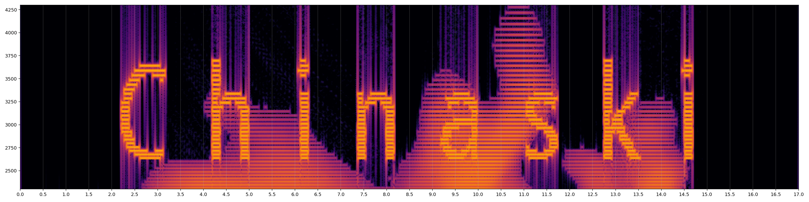

# 2(-1) Senses

**Category:** OSINT · **Points:** 30 · **Solves:** 258 · **Challenge ID:** 48

> A sound has come from deep space. We have tried to decipher it but it seems to elude us.

## Challenge

> A sound has came from deep space. We have tried to decipher is but it seems to alude us.
>
> Please note, if you play this file it is advised you turn down your volume to prevent
> hearing damage.
>
> File provided: `2senses_puzzle.wav`
> Flag format: `CSSCTF{...}`

Attachment:

- `2senses_puzzle.wav` (omitted here for size — see **Files**)

## Initial analysis

The title is the whole hint. **"2(-1) Senses" = 2 − 1 = one sense**: you have hearing *and*
sight, but you are meant to use only one of them. The "turn down your volume" warning is
the tell — the audio is harsh on purpose so you *don't* listen to it. You **look** at it.

`2senses_puzzle.wav` is a 17-second, 44.1 kHz, 16-bit mono PCM WAV. Two fast wins:

1. **Metadata.** `exiftool`/`ffprobe` show the RIFF `IART` and ID3 `TPE1` (artist) tags
   carry a partial flag, and the RIFF `ICMT` / ID3 `COMM` (comment) tags carry the closing
   brace:

   ```
   Artist  (IART / TPE1): CSSCTF{WHOS_THIS_FLUFFMASTER_MR...
   Comment (ICMT / COMM): }
   ```

   So the file hands us the prefix, most of the body, and the `}` — but the piece after
   `MR` is three literal ASCII periods standing in for something the metadata won't say.

2. **Spectrogram.** Rendering an STFT spectrogram (`inspect_audio.py`, `focus.py`,
   `logspec.py`) reveals hand-drawn lettering painted into the ~2.6–3.7 kHz band across
   seconds 2–15 — the classic Aphex-Twin "face/word hidden in the spectrogram" trick.
   Reading left to right, the strokes spell **`Chinaski`** in title case (the committed
   `spectrogram_letters.png` shows it clearly; the last stroke is a dotted `i`, not a `!`).



## Vulnerability / core concept

Two channels, one answer: the **metadata** supplies the frame of the flag
(`CSSCTF{WHOS_THIS_FLUFFMASTER_MR...}`) and the **spectrogram image** supplies the word that
fills the `...`. The challenge rewards *looking* at the audio rather than listening to it —
exactly the "2(−1) senses" conceit.

## Exploitation

Reconstruct the flag:

```console
$ exiftool 2senses_puzzle.wav | grep -Ei 'artist|comment'
Artist  : CSSCTF{WHOS_THIS_FLUFFMASTER_MR...
Comment : }
```

```console
$ python3 inspect_audio.py      # banded STFT spectrograms
$ python3 focus.py              # zoom + median-whiten the 2.55-3.85 kHz band
# -> the drawn word reads: Chinaski
```

Splice the metadata frame and the drawn word, keeping the word's drawn **title-case**
spelling (the `...` placeholder after `MR` is replaced by `_Chinaski`):

```
CSSCTF{WHOS_THIS_FLUFFMASTER_MR  +  _Chinaski  +  }
```

A note on the gotcha that cost a submission: an early candidate normalised the drawn word
to all-caps (`...MR_CHINASKI}`) and was rejected. The spectrogram text is deliberate
artwork and its casing is load-bearing — it is written `Chinaski`, not `CHINASKI`.

**OSINT corroboration (optional but reassuring).** The flag words are lifted from Venetian
Snares' album *Songs About My Cats* — its
[official Bandcamp page](https://venetiansnares.bandcamp.com/album/songs-about-my-cats)
lists tracks named **`Chinaski`** and **`Fluff Master`** (→ `FLUFFMASTER`), and a track
named **`Look`** (the "use your eyes" nudge). That real-world album, like this challenge,
hides imagery in its spectrograms — which is exactly why both the transcription and the
visual-not-auditory reading check out.

## Flag

```
CSSCTF{WHOS_THIS_FLUFFMASTER_MR_Chinaski}
```

## Key takeaways

- When a WAV warns you not to listen, that's the hint: open a spectrogram and *look*.
- Always pull container metadata (`exiftool`/`ffprobe`) first — half this flag was sitting in the `IART`/`ICMT` tags.
- Spectrogram artwork preserves exact case; copy the word as drawn (`Chinaski`) rather than normalising it.

## Files

- `2senses_puzzle.wav` (1.5M) — **omitted**; the challenge audio. Reproduce the spectrograms from it with the committed scripts.
- `spectrogram_letters.png` (464K) — committed; one representative STFT view showing the drawn word.
- Other solver-generated spectrograms (`spectrogram*.png`, `focus_*.png`, `logspec*.png`, `look_reference.png`, `mystery.png`, each up to ~1.8M) are **omitted**; regenerate with `inspect_audio.py` / `focus.py` / `logspec.py`.
